# Kvist & Bjælke ApS – Secure Login Platform & Infrastructure

Compulsory assignment, 3rd semester, Computer Science (CDS.security & CDS.infrastructure)

- **Group members:** Thor, Frederik and Pattrick

## Contents

- [Introduction](#introduction)
- [Part 1 – CDS.security](#part-1--cdssecurity)
    - [1.1 Development of the login platform](#11-development-of-the-login-platform)
    - [1.2 Implementation](#12-implementation)
- [Part 2 – CDS.infrastructure](#part-2--cdsinfrastructure)
    - [2.1 The company's network](#21-the-companys-network)
    - [2.2 Development of an IP addressing plan](#22-development-of-an-ip-addressing-plan)
    - [2.3 Establishing a server on VLAN 571](#23-establishing-a-server-on-vlan-571)
    - [2.4 Establishing a client on VLAN 570](#24-establishing-a-client-on-vlan-570)
    - [2.5 Network design](#25-network-design)
    - [2.6 Testing and documentation](#26-testing-and-documentation)
- [Part 3 – Final submission](#part-3--final-submission)
    - [Final reflection](#final-reflection)
    - [AI disclosure](#ai-disclosure)

---

## Introduction

Kvist & Bjælke ApS wants a new login platform where security is considered from the start, and where users’ passwords can never be read in plaintext, even if someone gains access to the database. 
The company also wants to modernise its IT infrastructure with a structured network, where different types of devices are organised into separate networks.

This report documents our solution to both parts of the assignment.

In CDS.security, we developed a web-based login platform with role-based access (user, superuser and admin), built with ASP.NET Core and ASP.NET Core Identity as the backend, JWT for authentication, and a React frontend. 

In CDS.infrastructure, we planned an IP addressing plan with VLANs for the company’s devices, and deployed the login platform in a Docker container on an Ubuntu Server virtual machine on VLAN 571. 
We tested access to it from a client virtual machine on VLAN 570.

The two parts are connected: 
the platform from CDS.security runs on the infrastructure from CDS.infrastructure. 
The report is divided into one section per course, followed by a final reflection and a disclosure of how we used AI.

---

# Part 1 – CDS.security

## 1.1 Development of the login platform

### Description of the developed login platform

The login platform is a web application where users log in with a username and password. 
After logging in, they see a table of all users. 
What a user can do with the table depends on their role: a normal user can only read it, a superuser can manage normal users, and an admin can manage everyone. 
Users cannot choose their own role, and passwords are never stored or shown in plaintext. 
The solution is built to run in a Docker container.

### Technology choices and justification

- **ASP.NET Core Web API with ASP.NET Core Identity:** Identity is a mature, widely used library that handles password hashing, account lockout and roles. 
Using it means we don't write security-critical code ourselves.

- **JWT bearer tokens:** the API is stateless, so the React frontend can call it without server-side sessions. 
The token contains the user's roles, is signed so it can't be altered, and expires after 2 hours.

- **SQLite with Entity Framework Core:** a simple file-based database that is easy to run in Docker. 
EF Core uses parameterised queries, which protects against SQL injection.

- **React (TypeScript) with Bun:** a fast development setup for a simple user interface. 
The frontend only displays data. 
The security rules are enforced by the API.

- **Docker:** the application runs the same way on any server, which makes it easy to deploy on the virtual machine in Part 2.

### Roles and permissions

The platform has three roles. The permissions are enforced on the server, not only in the interface, so hiding a button is not what protects the data.

The screenshots below show the table as each role sees it.

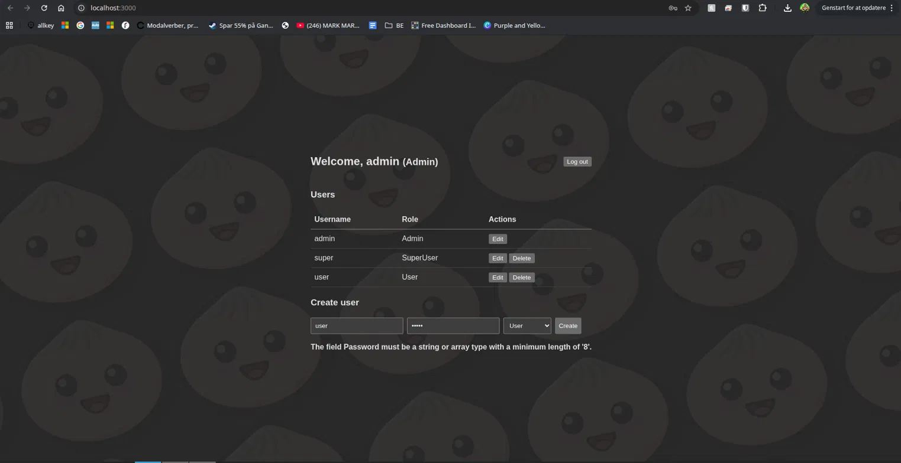
*Logged in as admin: can edit and delete users and superusers, and create any role.*

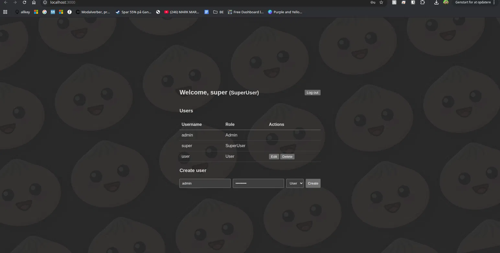
*Logged in as superuser: can only edit and delete users with the role User. The admin and superuser rows have no actions.*

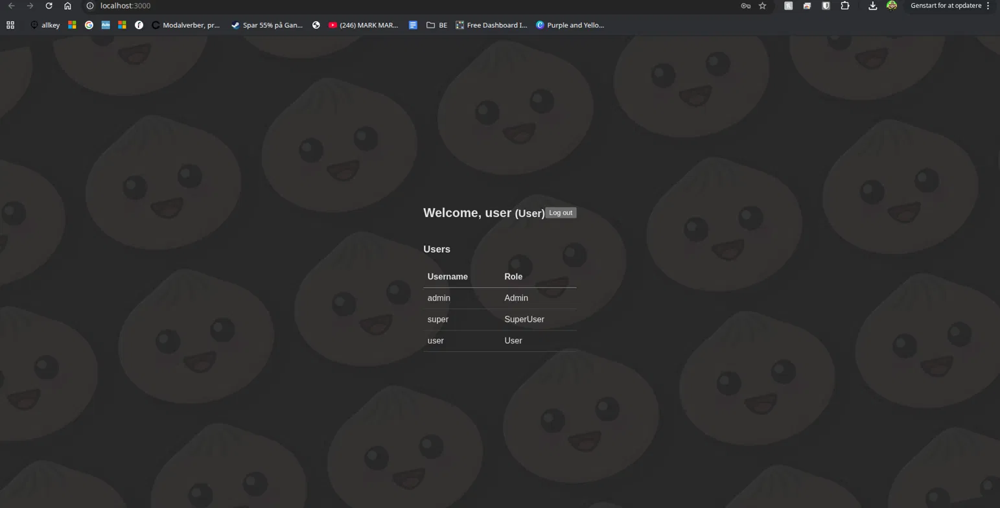
*Logged in as a normal user: read-only table, no actions and no create form.*

---

## 1.2 Implementation

### Authentication method

Users log in with a username and password. The API returns a signed **JWT** that contains the user's roles and expires after 2 hours. The frontend sends it with every request, and the API validates the signature, issuer, audience and lifetime.

So basically the API stays stateless, and the roles travel with the token. A wrong username and a wrong password give the same message, so an attacker can't find out which usernames exist.

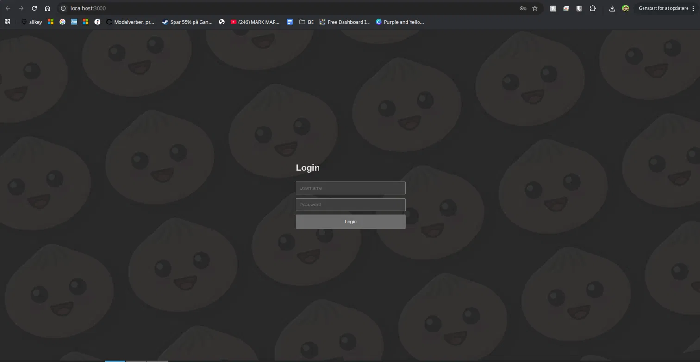
*The login page.*

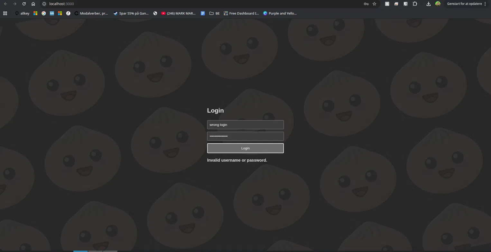
*A failed login gives a generic error message.*

### Password handling and storage

Passwords are never stored in plaintext. ASP.NET Core Identity stores only a salted hash, made with **PBKDF2 (HMAC-SHA512, 100,000 iterations)** and a random salt for each password. Passwords must have at least 8 characters, an uppercase and a lowercase letter, a digit and a symbol.

PBKDF2 is built into Identity and well tested, so we don't write security-critical code ourselves. The salt means two users with the same password get different hashes.

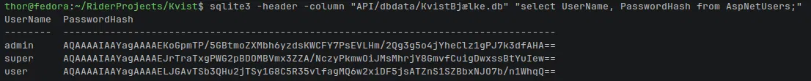
*The database contains only hashes, no readable passwords.*

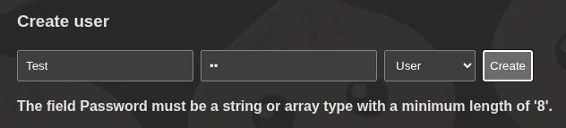
*A password that is too short is rejected.*

### Role-based authorization

Endpoints are protected with `[Authorize(Roles = ...)]`, and the controller also checks who the caller is trying to change. A SuperUser can only manage users with the role `User` and always creates plain `User` accounts. Nobody can delete themselves or change their own role.

The rules run on the server, so they also hold for requests sent directly to the API. Hiding a button in the frontend is not security.

### Other security features

- **Account lockout:** 5 failed logins lock the account for 5 minutes, which slows down brute-force attacks.
- **Input validation:** usernames and passwords are length-checked before they are processed.
- **Parameterised queries:** Entity Framework Core protects against SQL injection.

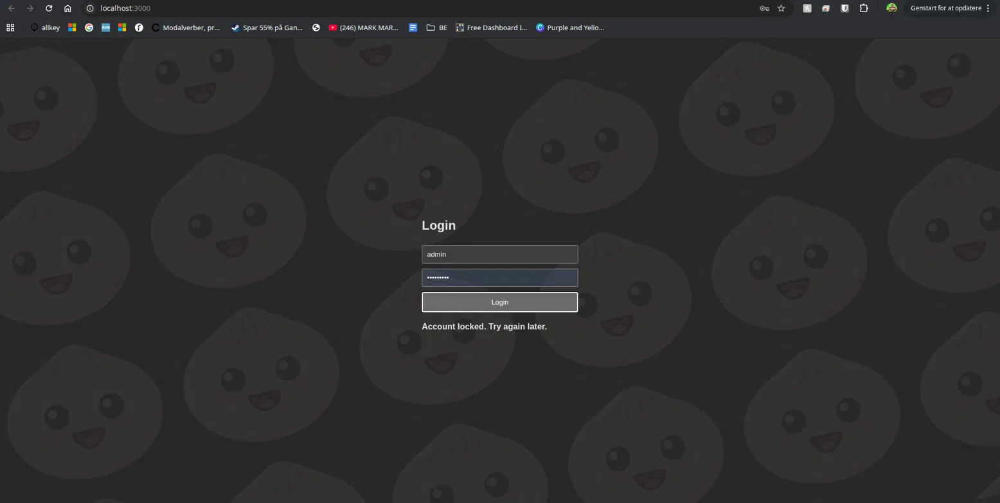
*After 5 failed attempts the account is locked.*

**Limitations:** the JWT is stored in `localStorage` (an XSS bug could expose it), CORS and Swagger are open in development, and the platform runs over HTTP in the lab. A production setup would add HTTPS and restrict both.

### Alternatives we found along the way

Argon2id and bcrypt are also built in and well tested. Argon2id is memory-hard and the current OWASP first choice.

### Source code

https://github.com/ThorJ05/Kvist

---

# Part 2 – CDS.infrastructure

## 2.1 The company's network

### Device overview
we have 53 units on our virtual machine including: 
Stationary pcs : 15.
portable pcs : 10.
networkprinters : 3.
server : 3.
ip - telephones: 12
wireless acces points : 4.
surviliance kameras : 6.

### Future expansion
The company may add employees and devices, so every network in our plan is larger than today's need. 
For example, the phone network holds 30 devices for 12 phones, and each type of device has its own VLAN, so one group can grow without affecting the others. 
There is also room in the 10.5.0.0/16 range for new VLANs.

---

## 2.2 Establishing a server on VLAN 571

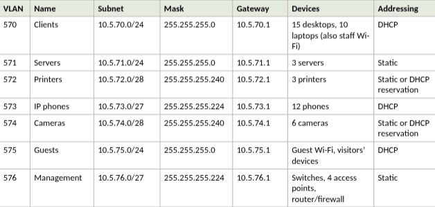
*The VLAN plan: one network per type of device.*

We split the company's network into seven VLANs, one for each type of device: clients, servers, printers, IP phones, cameras, guests and management. 

VLAN 570 (clients, 10.5.70.0/24) and VLAN 571 (servers, 10.5.71.0/24) were given by the assignment, and we continued the same pattern for the rest (VLAN 57N uses 10.5.7N.0). 
All networks use private 10.5.x.x addresses, and each network has its own gateway. 
Keeping the device types apart means a problem in one network, such as an infected guest device or a compromised camera, can't spread to the servers, and the firewall can control exactly what each network may reach.

---

## 2.3 Establishing a client on VLAN 570

We cloned the repository to the server and started it with Docker Compose. It runs two containers, the web application and the API, and the database is stored on a Docker volume.

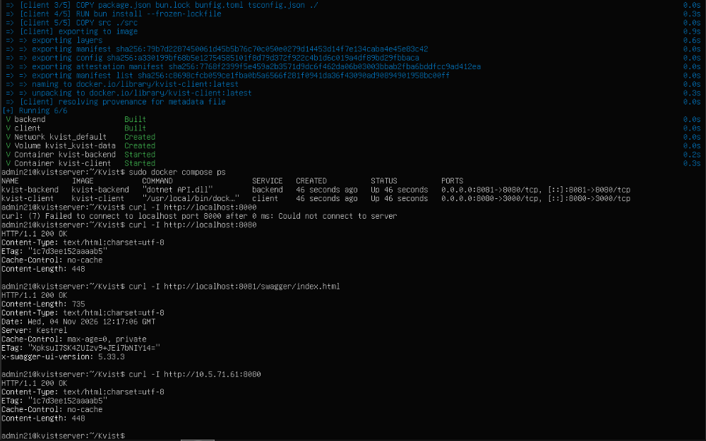
Docker compose ps shows both containers running, and curl gets 200 OK from the server's address, 10.5.71.61.
The web application is published on port 8080 and the API on port 8081. 
Both are inside the required range 8000–8100.

From the client VM on VLAN 570 we opened http://10.5.71.61:8080 in a browser and logged in as admin. 
The platform works from the client, which shows that the firewall allows traffic from VLAN 570 to the server on VLAN 571.

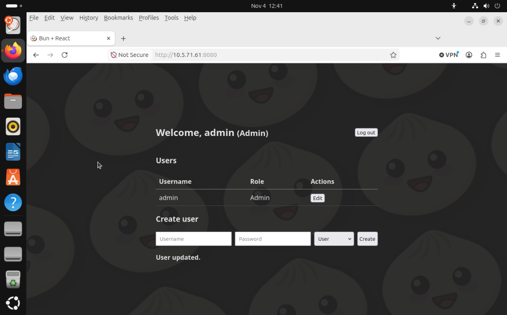
The client (VLAN 570) logged in to the platform running on the server (10.5.71.61:8080).

---

## 2.6 Testing and documentation

### Server – VLAN 571

- Ubuntu Server installed: 
- Correct IP configuration: TODO
- Docker installed and working: TODO
- Login platform running in a Docker container: TODO
- Login platform accessible through the selected port: TODO

### Client – VLAN 570

- Correct IP configuration: TODO
- Client can access the login platform on VLAN 571: TODO
- Login platform's functionality can be used from the client: TODO
- ///Skriv, hvilken IP, subnetmaske og gateway klienten har (fx 10.5.70.x/24, gateway 10.5.70.1) og om den er DHCP eller statisk.
Vedhæft screenshot af ip a og ip route (Linux) eller ipconfig (Windows).
Nævn, at VM’ens netværkskort i Proxmox har VLAN-tag 570.

### Problems encountered and how we solved them
TODO

---

# Part 3 – Final submission

## Final reflection

### How are security and infrastructure interconnected?
It is interconnected since an applikation will never be more secure than the enviorment its running in. our applikations safety is depended on the infastructre. we seperaated our server so its not on the same network, by seperating it into diffrent VLAN´s. 

### What technical challenges did we encounter?
There weren't too many technical errors, however we did stumble upon a couple of merge conflicts, that were swiftly fixed.

### What did we learn about deploying an application on a server?
TODO

### What would we do differently in a real company?
We would have used git issues and used more branching, for better communication, workflow and less git conflicts. 

---

## AI disclosure

We used AI assistants in this project: **Claude (Anthropic), Copilot and DeepSeek.** 
The AI assistants were mainly used for the purpose of assisting the ReadMe structure, code optimisation and suggestions.
The assistance of AI helped the group performe quicker and in a more structured manner. 

